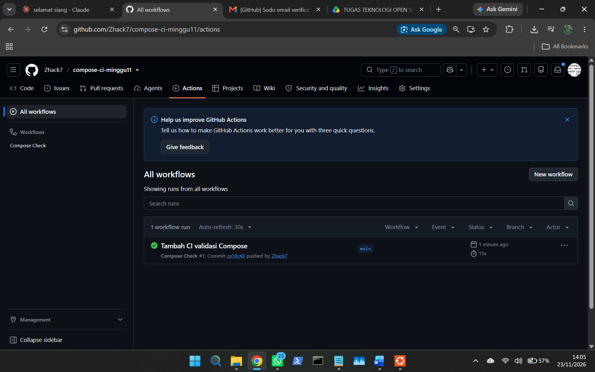
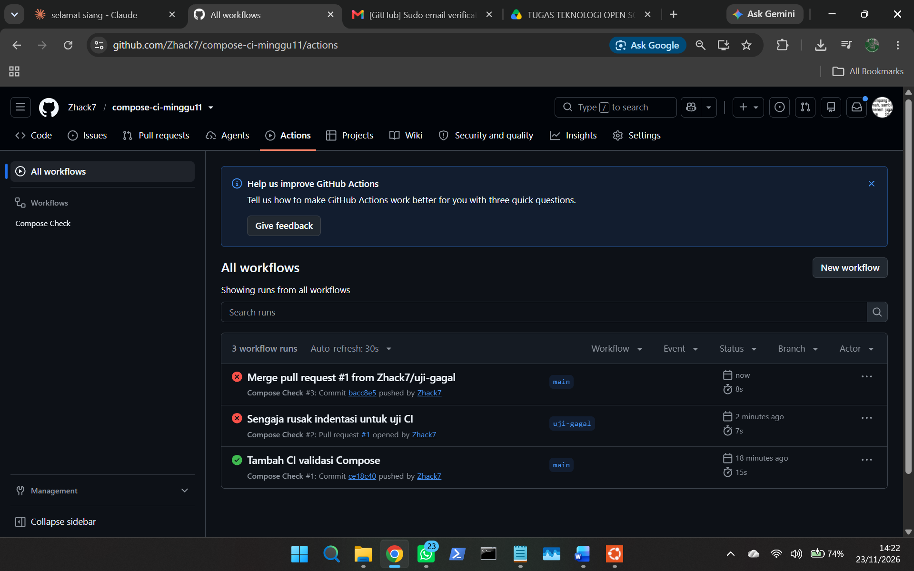

# compose-ci-minggu11

# Tugas Minggu 11: CI untuk Repo Compose

**Nama:** Muhammad Ngainurrozaq
**NIM:** 202557201065
**Mata kuliah:** Teknologi Open Source

## Deskripsi
Workflow ini memvalidasi sintaks file docker-compose.yml (stack WordPress + MariaDB) dengan perintah `docker compose config -q`. Workflow berjalan otomatis setiap ada push ke branch main dan setiap ada Pull Request.

## Isi repositori
- .github/workflows/compose-check.yml : workflow CI
- docker-compose.yml : stack WordPress + MariaDB (tugas minggu 10)
- .env.example : contoh variabel lingkungan tanpa rahasia asli
- .gitignore : mengabaikan .env
- bukti/ : tangkapan layar bukti pengerjaan

## Cara kerja workflow
Workflow bernama Compose Check dipicu oleh dua event, yaitu push ke branch main dan pull_request. Workflow punya satu job bernama validate yang berjalan di runner ubuntu-latest, dengan tiga step. Step pertama (actions/checkout@v6) mengambil kode repositori ke runner. Step kedua menyalin .env.example menjadi .env, karena file .env asli tidak ada di repositori. Step ketiga menjalankan `docker compose config -q` untuk memeriksa sintaks file Compose tanpa menjalankan container. Jika sintaksnya rusak, step ketiga gagal dan check berwarna merah.

## Bukti
1. Run hijau di tab Actions
   
2. Pull Request dengan check gagal (merah)
   
3. Badge status di README
   

Tautan Pull Request (sudah hijau dan di-merge): https://github.com/Zhack7/compose-ci-minggu11/pull/2 

## Kendala dan cara mengatasinya
<!-- GANTI bagian ini dengan kendala yang benar-benar kamu alami -->
Saya mengalami kesulitan dibagian upload gambar karna susah menemukan keberadaan bukti foto tersebut didalam folder komputer saya sehingga membingungkan saya dalam melakukan perintah upload di ubuntu

## Refleksi singkat
<!-- SESUAIKAN dengan kata-katamu sendiri -->
Dengan CI, setiap perubahan pada file Compose langsung diperiksa oleh GitHub tanpa saya harus mengujinya secara manual. Saat saya sengaja merusak indentasi, kesalahan itu sudah ketahuan di Pull Request sebelum masuk ke branch main, sehingga branch utama tetap sehat. Pola ini bisa saya pakai di tugas atau proyek lain agar kesalahan konfigurasi tertangkap lebih awal.
