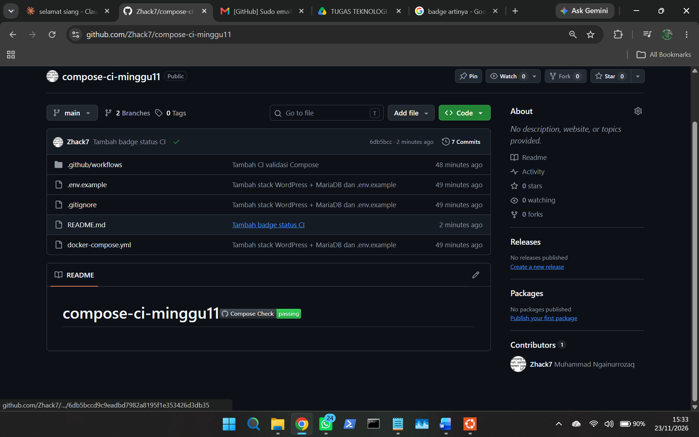

# compose-ci-minggu11

# Tugas Minggu 11: CI untuk Repo Compose

**Nama:** Muhammad Ngainurrozaq
**NIM:** 202557201065
**Mata kuliah:** Teknologi Open Source

## Deskripsi
Workflow ini memvalidasi sintaks file docker-compose.yml (stack WordPress + MariaDB) dengan perintah `docker compose config -q`. Workflow berjalan otomatis setiap ada push ke branch main dan setiap ada Pull Request.

## Isi repositori
- .github/workflows/compose-check.yml : workflow CI
- docker-compose.yml : stack WordPress + MariaDB (tugas minggu 10)
- .env.example : contoh variabel lingkungan tanpa rahasia asli
- .gitignore : mengabaikan .env
- bukti/ : tangkapan layar bukti pengerjaan

## Cara kerja workflow
Workflow bernama Compose Check dipicu oleh dua event, yaitu push ke branch main dan pull_request. Workflow punya satu job bernama validate yang berjalan di runner ubuntu-latest, dengan tiga step. Step pertama (actions/checkout@v6) mengambil kode repositori ke runner. Step kedua menyalin .env.example menjadi .env, karena file .env asli tidak ada di repositori. Step ketiga menjalankan `docker compose config -q` untuk memeriksa sintaks file Compose tanpa menjalankan container. Jika sintaksnya rusak, step ketiga gagal dan check berwarna merah.

## Bukti
1. Run hijau di tab Actions
   
2. Pull Request dengan check gagal (merah)
   
3. Badge status di README
   

Tautan Pull Request (sudah hijau dan di-merge): https://github.com/Zhack7/compose-ci-minggu11/pull/1

## Kendala dan cara mengatasinya
1. **Push ditolak (Authentication failed).** Muncul pesan `Invalid username or token. Password authentication is not supported for Git operations.` karena Git lewat HTTPS tidak menerima password akun. Saya membuat Personal Access Token di GitHub dan memakainya sebagai password.
2. **Peringatan variable is not set.** Saat menjalankan `docker compose config -q` di hasil clone muncul `The "DB_NAME" variable is not set. Defaulting to a blank string.` Penyebabnya file .env tidak ikut repositori karena diabaikan .gitignore. Saya membuatnya dari contoh dengan `cp .env.example .env`.
3. **Gambar bukti tidak ditemukan saat disalin.** Perintah cp menampilkan `cannot stat 'User/Pictures/1-run-hijau.png'` karena saya memakai folder pengguna Windows yang salah (Default User) dan namanya mengandung spasi. Saya mencari nama yang benar dengan `ls /mnt/c/Users/`, lalu menyalin dari `/mnt/c/Users/rozaq/Downloads/`.
4. **Commit gagal karena lupa git add.** Muncul `nothing added to commit but untracked files present`. Saya menjalankan `git add bukti README.md` sebelum commit.
5. **Pull Request ter-merge saat check masih merah.** Tombol Merge tetap aktif walaupun check gagal. Saya mengulang percobaan dari repositori baru dan baru menekan Merge setelah check berubah hijau.

## Refleksi singkat
Dengan CI, setiap perubahan pada file Compose langsung diperiksa oleh GitHub tanpa saya harus mengujinya secara manual. Saat saya sengaja merusak indentasi, kesalahan itu sudah ketahuan di Pull Request sebelum masuk ke branch main, sehingga branch utama tetap sehat. Pola ini bisa saya pakai di tugas atau proyek lain agar kesalahan konfigurasi tertangkap lebih awal.

